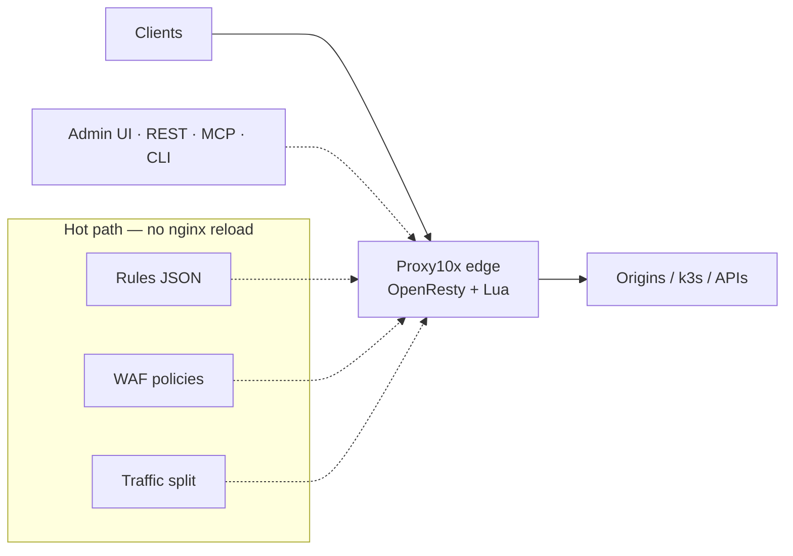
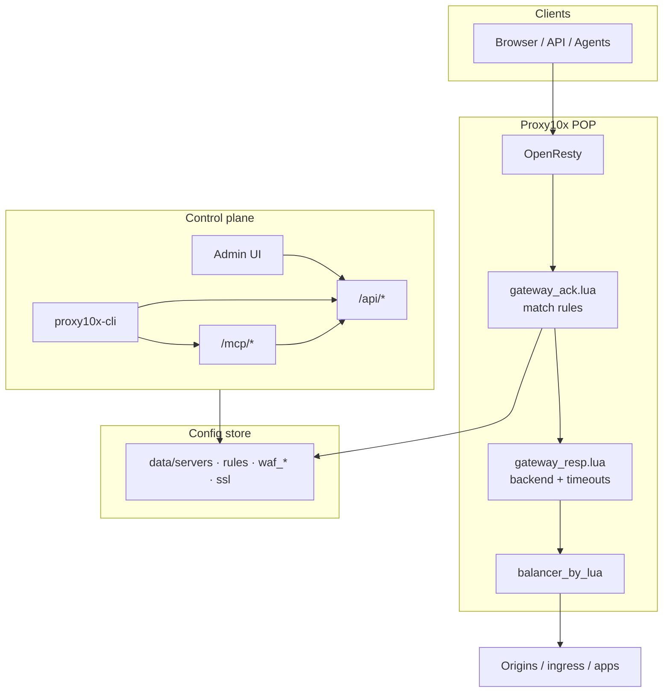
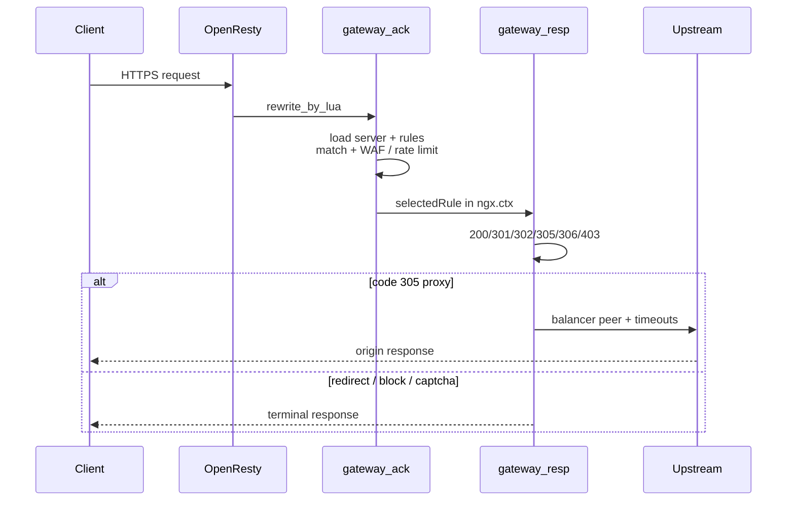
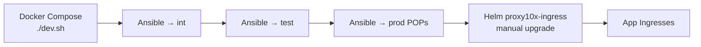

# Proxy10x

**The proxy POP and API gateway for AI-assisted development.** Proxy10x runs on OpenResty at the edge: it routes, secures, caches and observes traffic for your apps and AI agents, from JSON configs that take effect **without reloading nginx**.

It is built so AI coding agents can operate it as safely as people do. Every virtual host, rule, WAF policy, cache setting and traffic split is plain JSON behind a REST API and MCP tools, so an agent can propose, diff and apply a change, and a person can review it before it reaches production. Run it as one container or as a fleet of edge POPs.

Part of the [TenthMatrix](https://www.tenthmatrix.com) product family. Lives in the TenthMatrix monorepo at `products/proxy10x/`.

| | |
|---|---|
| Site | [proxy10x.com](https://proxy10x.com) |
| Swagger | [proxy10x.com/swagger/](https://proxy10x.com/swagger/) |
| Repo | [github.com/bwalia/tenthmatrix](https://github.com/bwalia/tenthmatrix/tree/main/products/proxy10x) (`products/proxy10x/`) |
| Images | `bwalia/proxy10x`, `ghcr.io/bwalia/proxy10x-cli` |

> **CI is not wired yet.** The workflows under [`.github/workflows/`](.github/workflows/) were carried over but are inactive: GitHub only runs workflows from the repository root. Port them one at a time into the root `.github/workflows/` with a `paths: ['products/proxy10x/**']` filter and `working-directory: products/proxy10x`, and create the `proxy10x*` image repositories and secrets before they run.

---

## What it is

Proxy10x sits in front of your origins and decides **per request** what happens: proxy (305), redirect, static block, CAPTCHA, WAF, cache, canary split, geo/IP/JWT match — using rules loaded live from disk or Redis.



**Reload only when server-level nginx conf changes** (new listen/SSL block). Rules, WAF, and most routing are evaluated every request.

---

## Capabilities (today)

| Area | What you get |
|------|----------------|
| **Routing** | Path / IP / country / JWT / S3 / cookie match → proxy, redirect, HTML, CAPTCHA; priority + specificity tie-break |
| **Traffic** | Weighted / RR / header canary / cookie sticky / least-conn; promote & rollback backends |
| **WAF** | Policy packs, anomaly scoring, monitor/block, events API — see [docs/WAF_ENGINE_V2.md](docs/WAF_ENGINE_V2.md) |
| **SSL** | auto-ssl / Let's Encrypt, per-domain SSL JSON, force HTTPS |
| **Cache** | Edge static cache + optional Docker blob cache; Varnish hooks |
| **POPs + DNS** | Declare edge locations; Cloudflare A-record provisioning with safety guardrails — [POPS_AND_DNS_GUIDE.md](POPS_AND_DNS_GUIDE.md) |
| **Control plane** | React Admin + Next.js dashboard, Swagger REST, MCP (Claude/Cursor), `proxy10x-cli` |
| **Deploy** | Docker Compose (dev), Ansible (bare metal / VM), Helm ingress-controller (k3s) |
| **Observability** | `/health` `/healthz` `/ready` `/metrics`, traffic stats, AI log analysis hooks |
| **Geo traffic** | Geographic Traffic Distribution on the admin dashboard (Top Countries + world map via IP2Location) — [2-min video](https://youtu.be/4G_YPYj3J3k) · [article](https://proxy10x.com/blog/geographic-traffic-distribution.html) |

---

## Architecture



**Two-layer prod pattern (common):** public POP → k3s NodePort → `proxy10x-ingress` Helm chart → app pods. Tune timeouts on **both** layers.

More diagrams (Draw.io): [docs/diagrams/](docs/diagrams/).

---

## Quick start

### Docker (local)

```bash
git clone https://github.com/bwalia/tenthmatrix.git && cd proxy10x
./dev.sh -n -j "$(openssl rand -hex 24)"
# Admin: http://localhost:8280   API: http://localhost:8280/api   Health: /health
```

Or compose: `docker-compose -f docker-compose-local.yml up` (see [DOCKER.md](DOCKER.md)).

### CLI in CI (no Go install)

```bash
docker run --rm \
  -e PROXY10X_BASE_URL=https://your-pop.example \
  -e PROXY10X_TOKEN \
  ghcr.io/bwalia/proxy10x-cli:latest check nginx -o json
```

Docs: [docs/proxy10x-cli.md](docs/proxy10x-cli.md) · examples under `examples/proxy10x-cli/`.

### Login + pull / push config

```bash
proxy10x-cli auth login --base-url https://lon1.pop0.uk -u you@example.com
proxy10x-cli pull -d ./cfg --resources servers,rules,waf_rules,waf_policies
# edit JSON or jq …
proxy10x-cli push -d ./cfg --dry-run --diff
proxy10x-cli push -d ./cfg --yes --verify
```

---

## Request pipeline (simplified)



---

## Repository map

| Path | Role |
|------|------|
| `api/` | Lua gateway + REST + MCP (hot-reloaded) |
| `data/` | Servers, rules, WAF, SSL JSON (per env profile) |
| `openresty-admin-next/` | Next.js ops dashboard |
| `html/` | Public landing + swagger |
| `cmd/proxy10x-cli/` | Go CLI + Dockerfile |
| `infra/ansible/` | Production deploy (OpenResty build, nginx, data, UIs) |
| `ingress-controller/` | k3s Helm ingress chart |
| `docs/` | Guides (MCP, WAF, CLI, diagrams) |

Developer deep-dive: [CLAUDE.md](CLAUDE.md).

---

## Deploy paths



- **Delivery pipeline:** `.github/workflows/deploy-proxy10x-delivery-pipeline.yml` (int → smoke → test → prod)
- **CLI binaries + image:** `.github/workflows/build-proxy10x-cli.yml` → GHCR + release `proxy10x-cli-latest`
- Ansible playbook: `infra/ansible/proxy10x-ops.yml`

---

## MCP (AI agents)

Enable in `data/settings.json` → `mcp`. Endpoints: `/mcp/manifest`, `/mcp/tools`, `/mcp/jsonrpc`.

Tools include `validate_config`, CRUD for servers/rules, WAF bind, traffic promote/rollback, POPs/DNS — see [docs/mcp.md](docs/mcp.md) and [api/mcp/README.md](api/mcp/README.md).

---

## Documentation index

| Doc | Topic |
|-----|--------|
| [docs/proxy10x-cli.md](docs/proxy10x-cli.md) | CLI + Docker CI usage |
| [docs/WAF_ENGINE_V2.md](docs/WAF_ENGINE_V2.md) | WAF engine |
| [docs/mcp.md](docs/mcp.md) / [mcp-gateway.md](docs/mcp-gateway.md) | MCP |
| [POPS_AND_DNS_GUIDE.md](POPS_AND_DNS_GUIDE.md) | POPs & Cloudflare DNS |
| [DOCKER.md](DOCKER.md) / [DOCKER-DEPLOYMENT.md](DOCKER-DEPLOYMENT.md) | Containers |
| [docs/diagrams/](docs/diagrams/) | Draw.io architecture set |
| [examples/proxy10x-waf-demo/](examples/proxy10x-waf-demo/) | WAF demo pack |

---

## Local URLs (`./dev.sh`)

| Service | URL |
|---------|-----|
| Admin | http://localhost:8280 |
| API / Swagger | http://localhost:8280/api · /swagger/ |
| Health | http://localhost:8280/health |
| Proxy HTTP/HTTPS | http://localhost:8180 · https://localhost:8443 |

---

## Contributing

PRs against `main`. Prefer small, focused changes. Do not commit real `settings.json` secrets or `.env` credentials.

## License

See repository license file.
